# SmartFoot Panorama

SmartFoot Panorama is a Windows desktop app that turns an ordinary flatbed document scanner into a station for screening the sole of the foot. The person stands on a platform with one foot on a 10 mm acrylic window, a Canon CanoScan LiDE 300 scans it from below, and the app checks the image, saves it, measures the footprint and helps the operator record a short diabetic-foot risk assessment. Version 0.2 is built around a whole day of screening at a community health post: one session per day and place, named patient folders, both feet per patient, and a summary the operator can read back to the patient. Version 0.3 adds what the operators asked for after the first field days: a two-page result sheet for the patient, made by the app itself, that can be sent over WhatsApp, and ways to go back, rescan and complete a patient's data later.


The app was built alongside the hardware, and most of what it does came from testing it against real scans on the real station. How version 0.1 got there, including the plan that was dropped and the bugs that negative testing found, is written up in [docs/JOURNEY.md](docs/JOURNEY.md).

## What it does

A day starts with a session: the place and the operator's name, with the date filled in automatically. From the session list the operator adds a patient, enters the basic details, and scans the left foot. The patient then turns around on the platform and the right foot is scanned the same way; seated patients simply move the other foot onto the glass. After each scan the review screen shows the outline the app found, says whether the whole foot is inside the scan area, and warns when something looks wrong, for example a cut-off heel, an empty glass, or a left and right foot that differ in length by more than a centimetre, which is how curled toes and a moving foot show up.

| Session list | Review with a length warning |
|---|---|
| 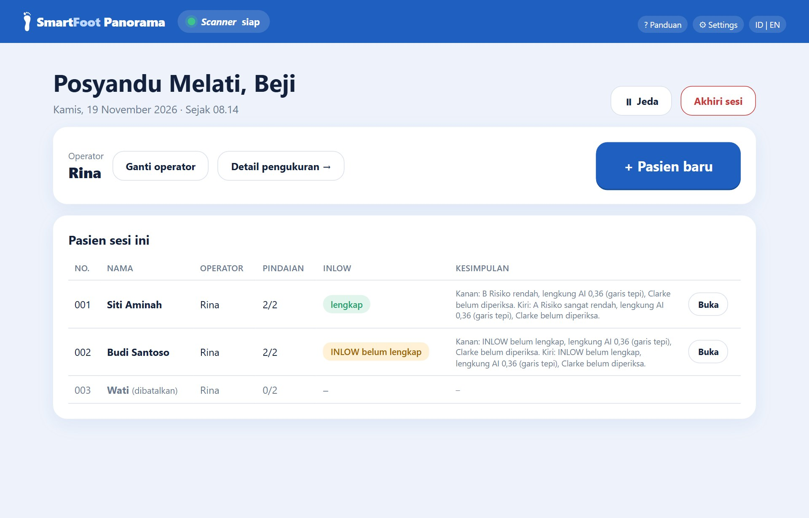 | 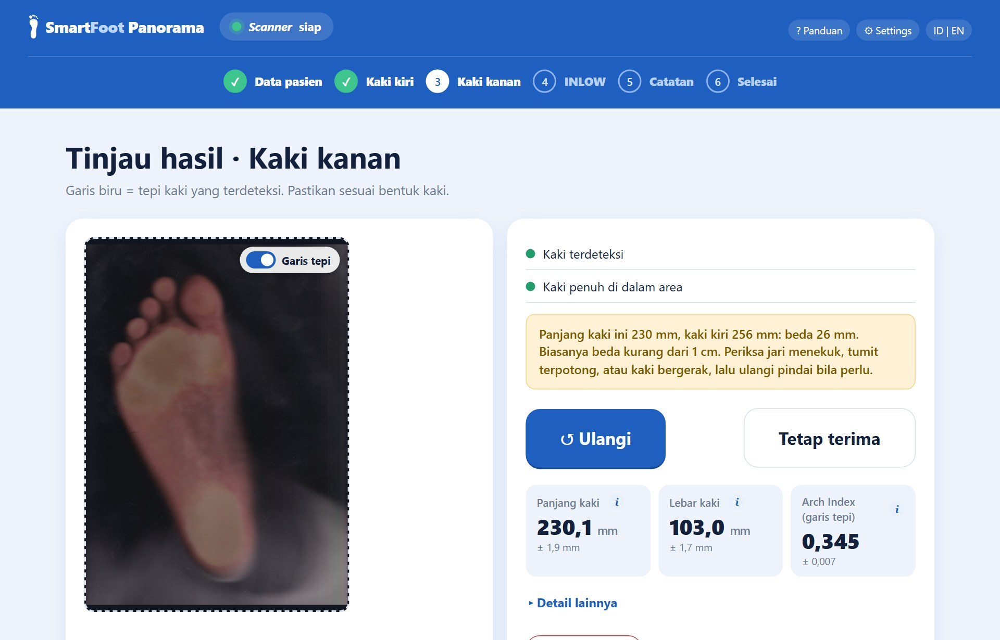 |

Clarke's angle is measured on a contact map that shows which skin actually presses on the glass. The app places the three points itself, but its guess is never reported as a result on its own: the operator checks the points one at a time, with a right and a wrong example beside each, and only a checked angle gets a flat, normal or high label (cut-off from Pita-Fernández et al., 2015). A foot can be skipped when the queue is long, and the app reminds the operator of unchecked feet before the session ends.

| Point check, one point at a time | Turning around for the right foot |
|---|---|
| 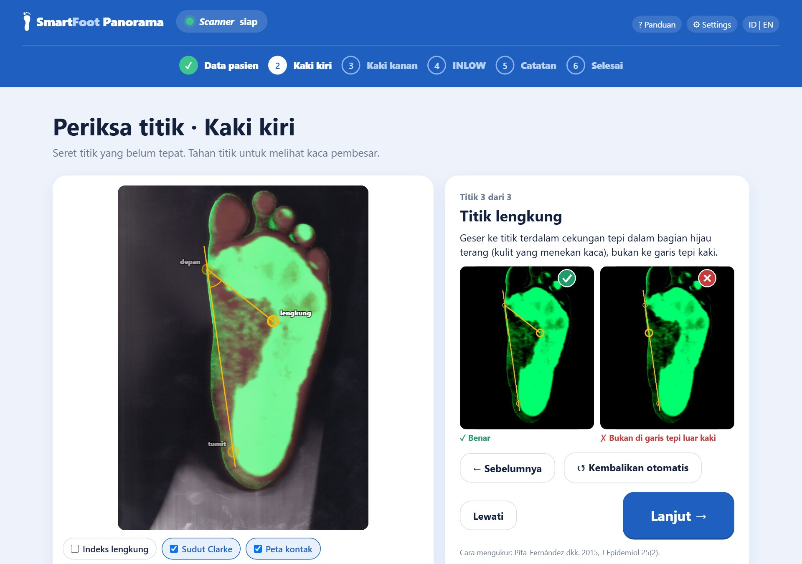 | 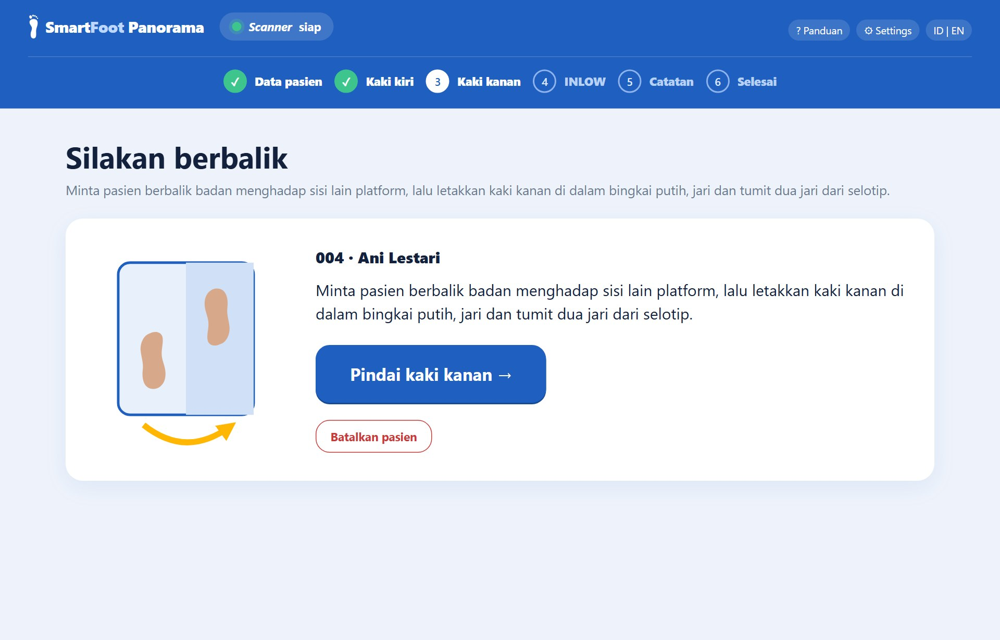 |

After both feet the operator fills in the INLOW 60-second foot screen as a tap form, adds notes or marks on the scan if needed, and finishes. The last screen gives a plain screening result per foot (arch shape, Arch Index, INLOW risk class) and the care advice that goes with the risk class. Everything is written to the patient's folder, to an Excel summary per session in the client's own column layout, to an Excel file covering all sessions, and to a research CSV.

| INLOW form | Screening result |
|---|---|
| 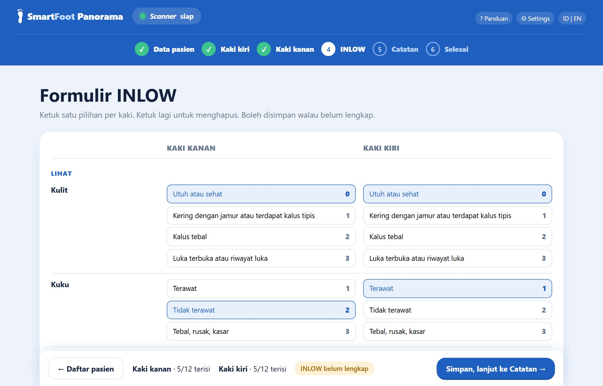 | 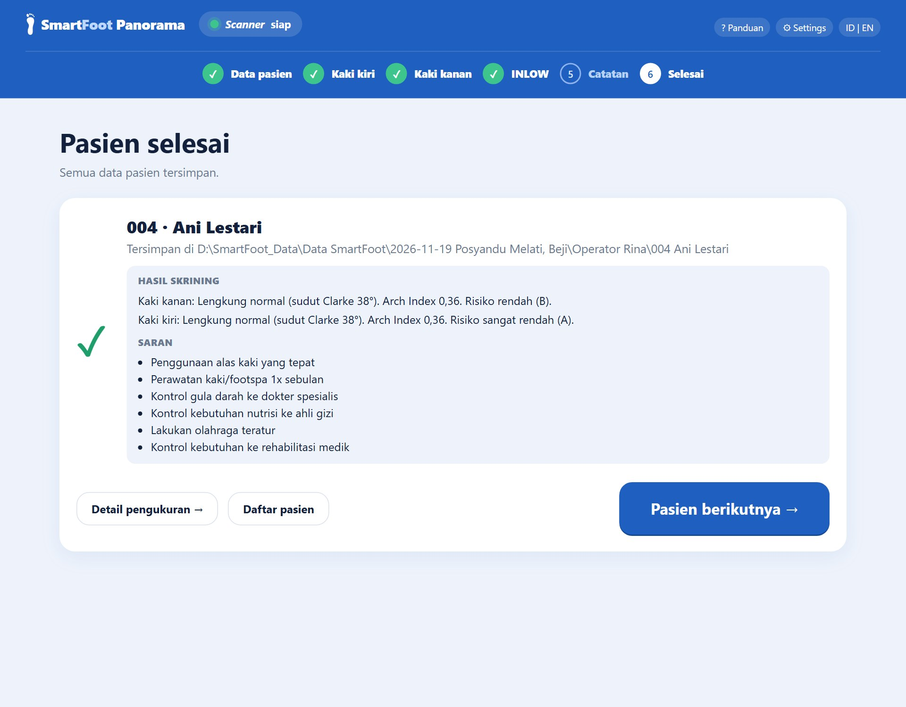 |

Around this core the app handles the things that go wrong at a real station. It watches the scanner and stops scanning when it is unplugged or locked, explains a cable pulled mid-scan in plain words, resumes a patient after the app was closed, mirrors every save to a backup folder, keeps working when the Excel file is open, and refuses to scan when the data folder on the flash disk is not there. The interface is in Indonesian by default with an English toggle, and the "? Panduan" button opens the operator book that ships next to the app.

## What is new in version 0.3

The operators wanted to give each patient something to take home, so every finished patient now gets a result sheet: a two-page PDF in the patient's folder, written in plain Indonesian for the patient rather than for the team. The first page gives each foot a status in words, the two or three actions that matter most, the warning signs that should send the patient to a doctor, and the photo, contact map and measurements of each foot; the measurements only appear once a person has checked that foot's points. The second page explains the pictures and the numbers. The sheet is typeset inside the app with an embedded copy of [Typst](https://typst.app), so it works offline, and it is made again automatically whenever the INLOW form, the notes, the points or a scan change. The wording on the sheet is a friendlier version of the client's advice table and is still being confirmed with the client; the app screens and the Excel files keep the client's own words.

| Result sheet, page 1 | Result sheet, page 2 |
|---|---|
| 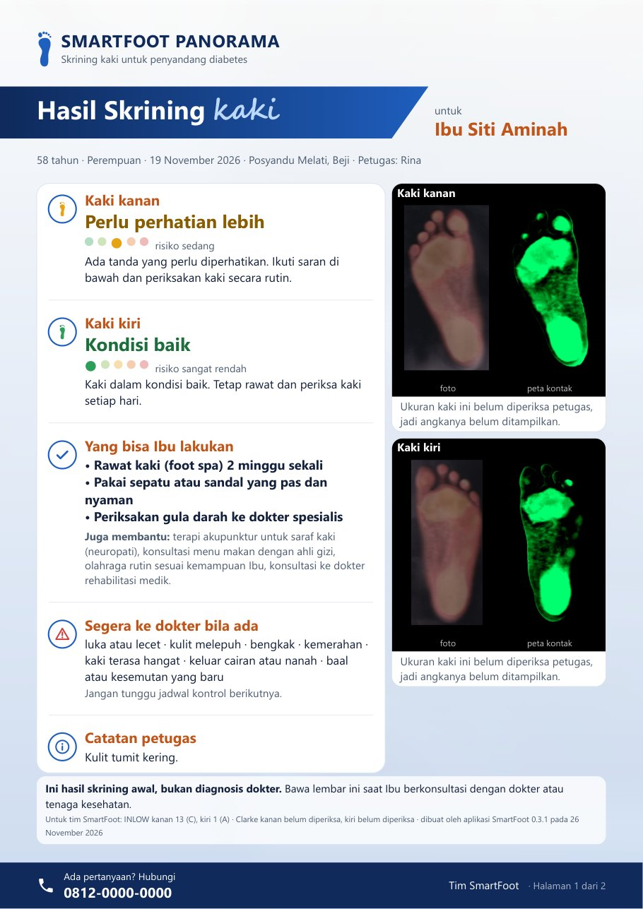 | 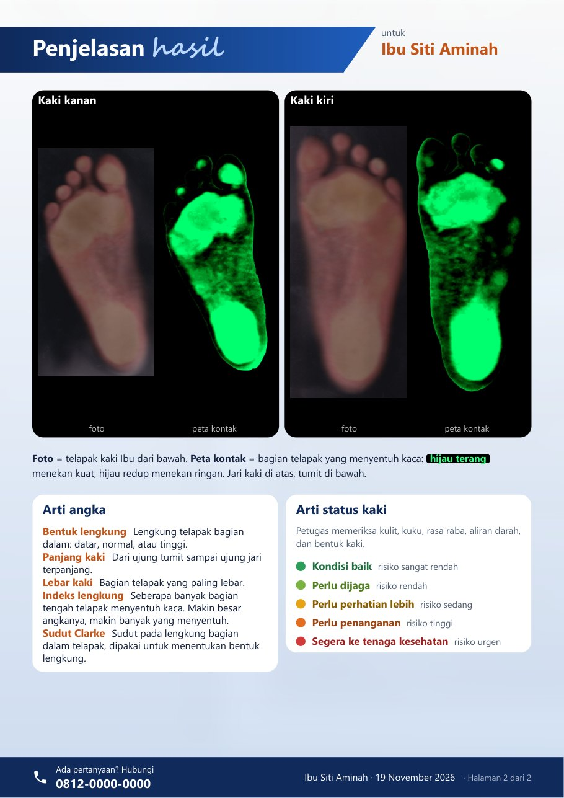 |

Sending the sheet is semi-automatic on purpose. With the patient's number and consent recorded on the patient form, "Kirim lewat WhatsApp" opens the chat in WhatsApp Desktop (or WhatsApp Web) with a short message already typed and the PDF on the clipboard; the operator pastes it, sends it, and presses "Sudah terkirim", which records who sent it and when. If the patient's data changes after that, the sheet is marked "kirim ulang". A patient in the highest risk class gets a red reminder to tell them in person and refer them to a health worker.

| Patient form with the first foot and WhatsApp consent | Sending the result sheet |
|---|---|
| 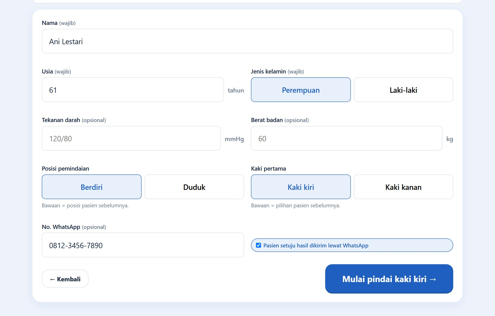 | 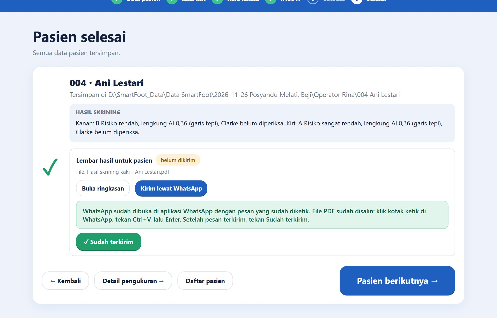 |

The patient flow also became more forgiving. The patient chooses which foot goes first, every patient screen has a "Kembali" button that keeps what was typed, and a foot that was already accepted can be scanned again from the step bar (the old scan is kept in the "ditolak" folder). After the patient has left, the INLOW form, the notes and the WhatsApp number can still be completed from "Detail pengukuran"; a "Perlu dilengkapi" filter lists the patients with something missing, and changes made after the session ended are recorded with the editor's name and the time. The Excel summaries gained one column, the WhatsApp number.

| Completing a patient later | Scanning an accepted foot again |
|---|---|
| 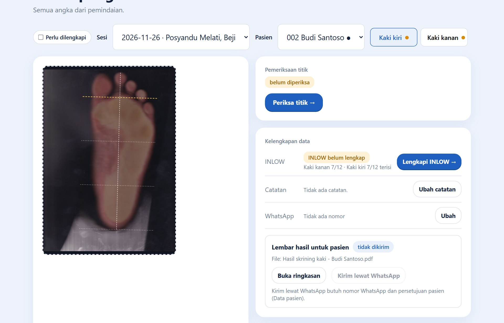 | 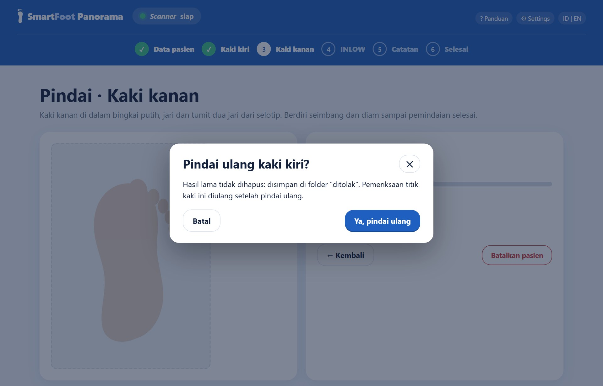 |

## Measured performance

The scale was calibrated on the final case with a steel and a plastic ruler laid on the acrylic: 300.7 dpi along the scan direction and 299.5 dpi across the sensor, both written into every session file.

On 19 November 2026 the station was tested with the white tape frame and the black cloth, standing. Repeated scans of the same left foot gave a foot length of 253 to 255 mm, also with the foot slanted, without the cloth and with the trousers left down. The same session showed the limits: curled toes shortened the foot by up to 26 mm and a moving foot by about 10 mm without a warning from the scan itself, which is why version 0.2 compares the two feet. Clarke's angle for one foot came out at 40° and 51° in two separate checks by the same person, so point placement varies more than the outline, and that spread is what the mandatory check is meant to measure.

## Testing

Version 0.1 was tested on purpose against things going wrong; the tests and fixes are listed in [docs/NEGATIVE_TESTS.md](docs/NEGATIVE_TESTS.md). Version 0.2 adds a hardware session on the real station (cut-off heel, empty glass, curled toes, moving foot, wrong foot, no cloth, USB pulled mid-scan, app closed mid-patient, Excel open, seated patients), and the fixes that came out of it. Version 0.3 adds tests for the result sheet (it is typeset from a sample session, must stay under 3 MB for WhatsApp, and is only made again when its content changes) and for the WhatsApp message, and its screens were clicked through in a headless browser against a stand-in backend before a real send through WhatsApp Desktop was tried on a laptop.

To run the tests, go to `src-tauri/` and run `cargo test`. Two tests also check the outline finder on real scans; they need the scan folders set in `SMARTFOOT_REF_SCANS` and `SMARTFOOT_CASE_SCANS` and skip themselves when the scans are not there.

## Building and running

The app is a [Tauri 2](https://tauri.app) project: the image processing, scanner access and storage are in Rust (`src-tauri/src`), and the interface is plain HTML, CSS and JavaScript (`src/`). It runs on Windows 10 or 11 and talks to the scanner through Windows Image Acquisition, using the driverless eSCL route of the LiDE 300.

```
npm install
npm run tauri dev      # run in development
npm run tauri build    # portable exe and installers in src-tauri/target/release
```

Ready-made builds and the operator book (Indonesian) are attached to the [releases](../../releases). The executables are not code-signed, so Windows SmartScreen asks for confirmation on first run (More info, then Run anyway).

## Limitations

The Arch Index is measured on the outline of the foot, which includes the lifted arch, so the published cut-offs for ink footprints do not apply and the app shows the number without a label. Clarke's angle depends on where a person places three points; the app's own guess is often wrong on feet whose contact print splits, which is why it must be checked. The result sheet's wording is a draft until the client confirms it, and WhatsApp messages go out from the operator's own account, since the programme has no number of its own yet. The app does not yet notice when the wrong foot is on the glass, and light leaking in beside the heel can be read as part of the foot when the cloth does not cover it. The figures above come from one person's feet. The app runs on Windows only and has been used with one scanner model.

## License

Copyright © 2026 Rennaafi. All rights reserved. The source is published for reading and reference; please ask before reusing it.
