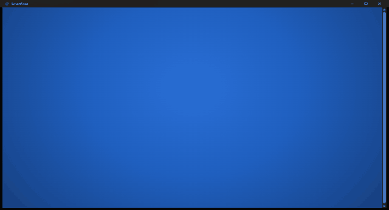
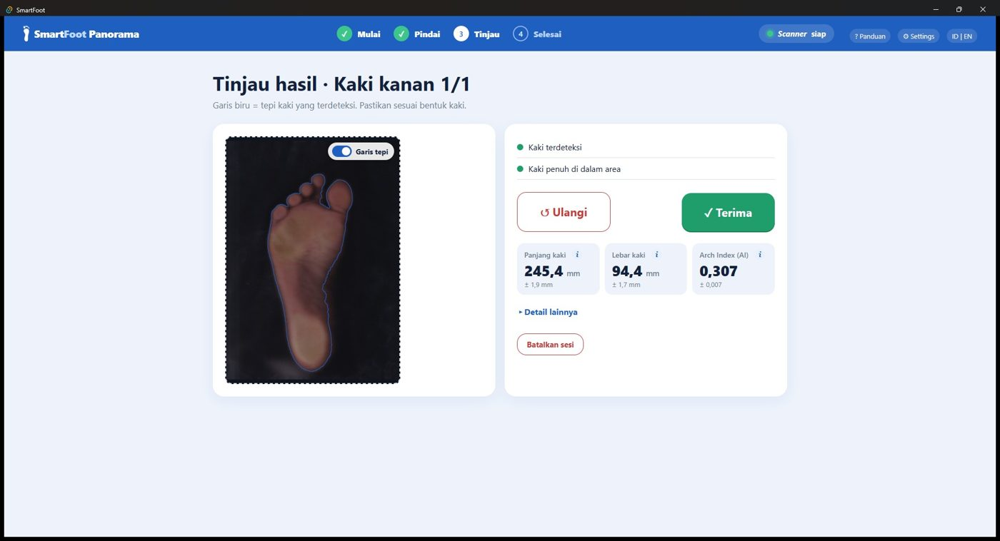
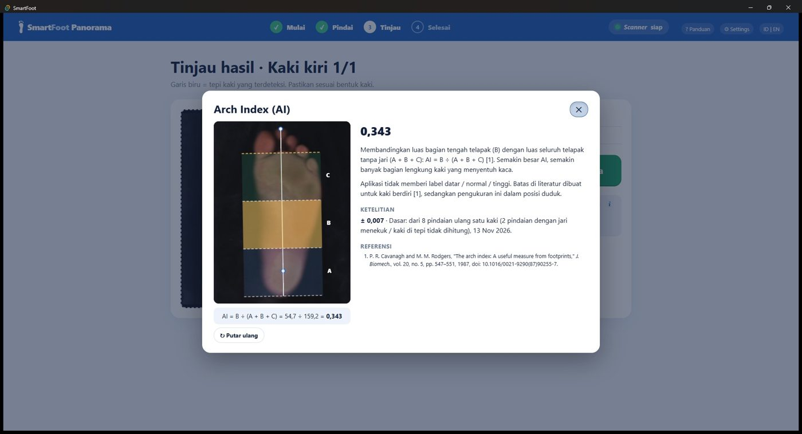
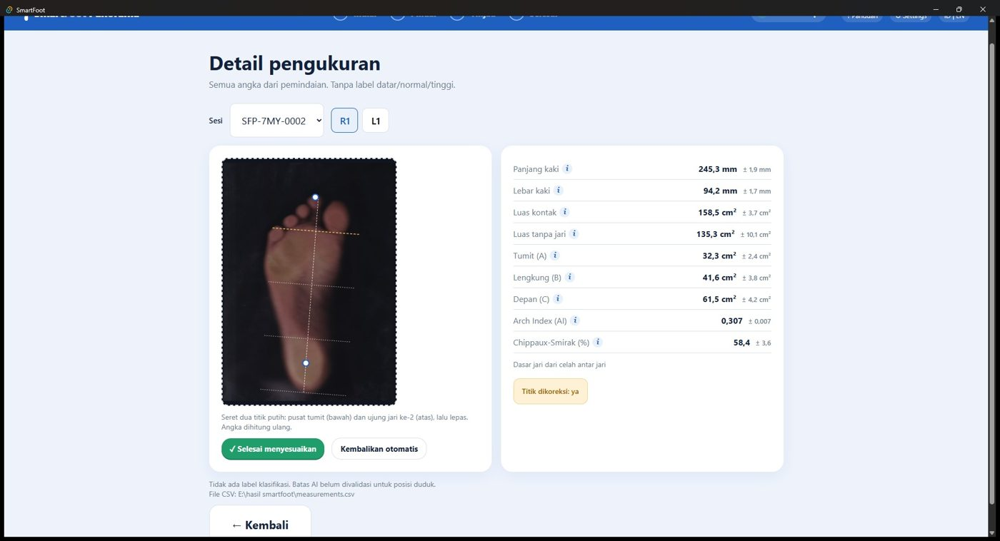
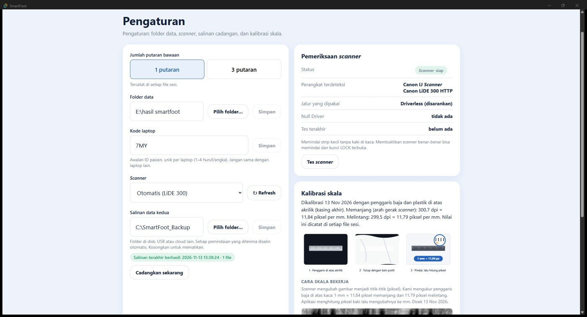

# SmartFoot Panorama

SmartFoot Panorama is a Windows desktop app that turns an ordinary flatbed document scanner into a station for imaging the sole of the foot. A seated person rests one foot on a 10 mm acrylic window, a Canon CanoScan LiDE 300 scans it from below, and the app checks the image, saves it to a session folder and measures the footprint: foot length, foot width, contact area, the Cavanagh arch index and the Chippaux-Smirak index.



The app was built in about two weeks alongside the hardware, and most of what it does today came from testing it against real scans on the real station. How it got here, including the plan that was dropped, the bugs that negative testing found and the measurements that shaped the calibration, is written up in [docs/JOURNEY.md](docs/JOURNEY.md).

## What it does

The operator flow has four steps: enter brief patient details (no name, a pseudo-ID is generated), scan one foot at a time, review the result, and finish. On the review screen the app draws the outline it found, says whether the whole foot is inside the scan area, and shows the three main numbers with their measured precision. Every number has an information button that explains it in plain words, animates how it is measured on the patient's own scan and cites its source.

| Review | Arch index explained on the patient's scan |
|---|---|
|  |  |

Behind the review screen there is a measurement detail view where the two reference points of the foot axis (heel centre and second-toe tip) can be moved by hand. A corrected scan is flagged in the data, and one button puts the points back where the app placed them.

| Measurement details with adjusted points | Scale calibration in Settings |
|---|---|
|  |  |

Around this core the app handles the things that go wrong at a real station. It watches the scanner and refuses to start when it is unplugged or locked, does a warm-up scan after a long idle, resumes a session that was interrupted by a crash or a closed window, mirrors every accepted scan to a second folder, blocks scanning when the data folder (for example a flash disk) is not reachable, and asks on a new laptop where the data should go. A short illustrated guide and a first-run tour explain the flow. The interface is in Indonesian by default with an English toggle.

## Measured performance

The scale was calibrated on the final case with a steel and a plastic ruler laid on the acrylic. Along the scan direction both rulers, on both their millimetre and inch scales, agree on 300.7 dpi within 0.1 %. Across the sensor the millimetre ticks are blurred out, so the inch marks give 299.5 dpi with about ±0.5 % uncertainty. Both values are written into every session file.

Repeatability was measured by placing the same right foot ten times, lifting it fully each time, under the black cloth with the room lights on. Two placements had curled toes or touched the edge and would have been retaken in normal use; over the remaining eight the app gives:

| Value | Mean | Precision (half the range) |
|---|---|---|
| Foot length | 244.8 mm | ± 1.9 mm (0.8 %) |
| Foot width | 94.1 mm | ± 1.7 mm (1.8 %) |
| Arch index | 0.304 | ± 0.007 (2.2 %) |

A tape measurement of the same foot gave 245 mm, 0.2 mm from the app's mean. These figures come from one foot of one person, so they describe how stable the station is, not how accurate it is across people.

## Testing

The app was tested on purpose against things going wrong before its first release build. The rule was that an accepted scan is never lost, a wrong number is never written silently, and every failure shows a message that says what to do. The automated suite covers empty glass, noise, tiny and corrupt images, a hanging scanner driver, two feet on the glass, a ruler mistaken for a foot, disk-full and unreachable backup folders, damaged settings files and crash recovery; a hands-on checklist covered unplugging, killing the app mid-save, two instances at once, a fake removable drive and a full disk. The tests, what each one found and how it was fixed are listed in [docs/NEGATIVE_TESTS.md](docs/NEGATIVE_TESTS.md).

To run the tests, go to `src-tauri/` and run `cargo test`. Two tests also check the outline finder on real scans; they need the scan folders set in `SMARTFOOT_REF_SCANS` and `SMARTFOOT_CASE_SCANS` and skip themselves when the scans are not there.

## Building and running

The app is a [Tauri 2](https://tauri.app) project: the image processing, scanner access and storage are in Rust (`src-tauri/src`), and the interface is plain HTML, CSS and JavaScript (`src/`). It runs on Windows 10 or 11 and talks to the scanner through Windows Image Acquisition, using the driverless eSCL route of the LiDE 300, which keeps more tonal range than the Canon driver.

```
npm install
npm run tauri dev      # run in development
npm run tauri build    # portable exe and installers in src-tauri/target/release
```

Ready-made builds are attached to the [releases](../../releases). The executables are not code-signed, so Windows SmartScreen asks for confirmation on first run (More info, then Run anyway).

## Limitations

The arch index cut-offs published in the literature were made for standing footprints, and this station scans a seated foot, so the app shows the number without a flat, normal or high label. The outline along the inner arch can be jagged where the lifted arch fades into the background, and gaps between curled toes can leave small notches. The precision figures above come from a single foot. The app runs on Windows only and has been used with one scanner model.

## License

Copyright © 2026 Rennaafi. All rights reserved. The source is published for reading and reference; please ask before reusing it.
