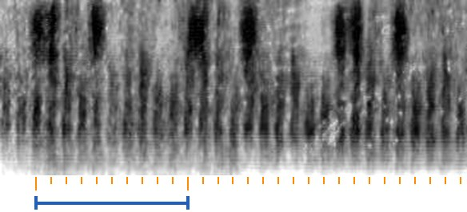
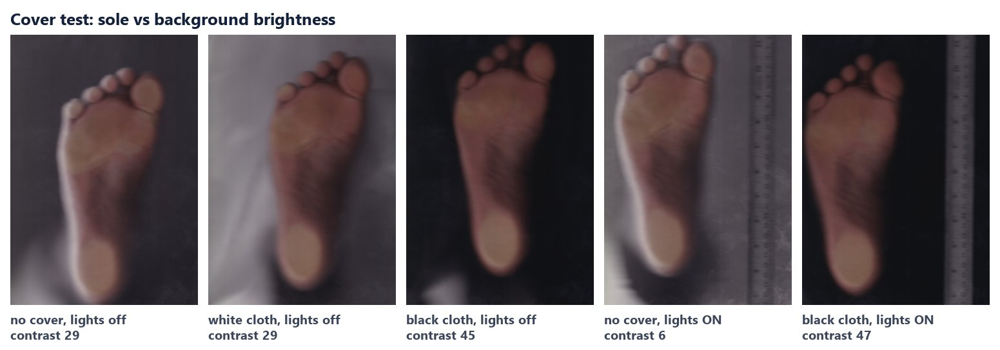
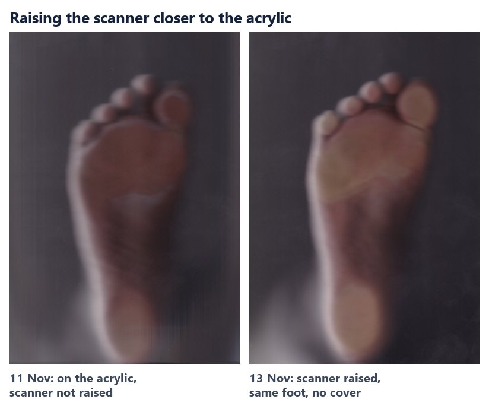
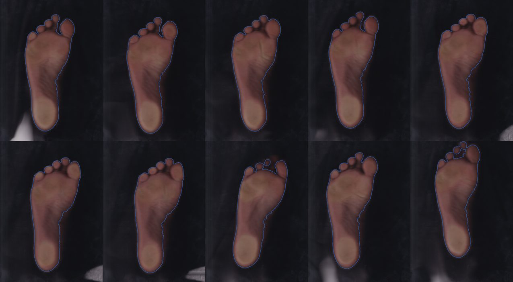
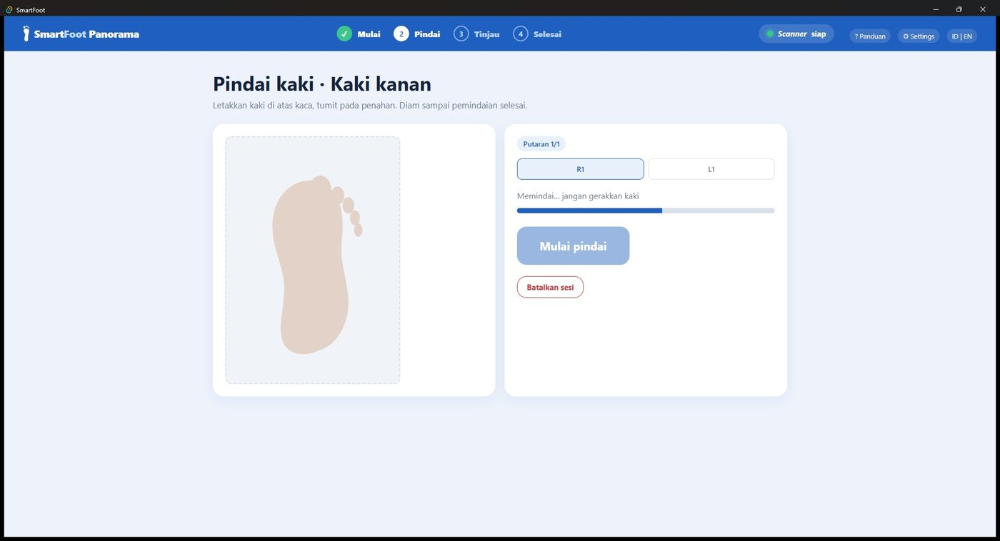
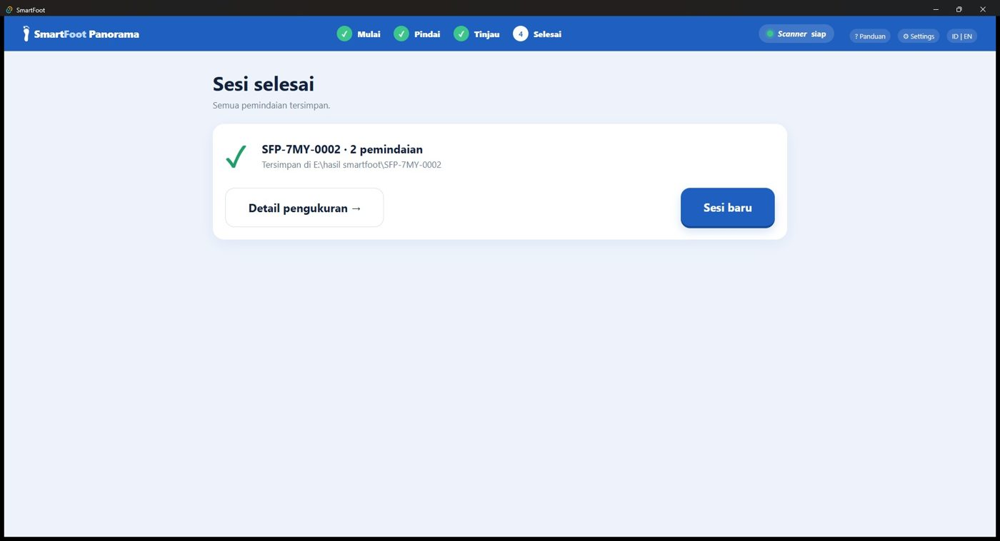
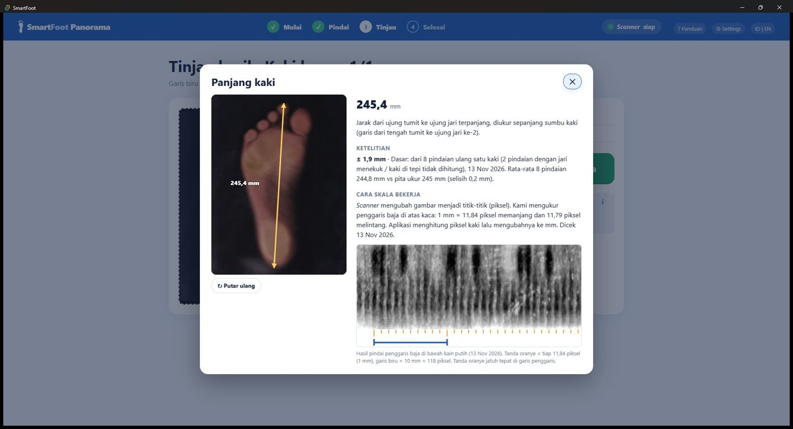
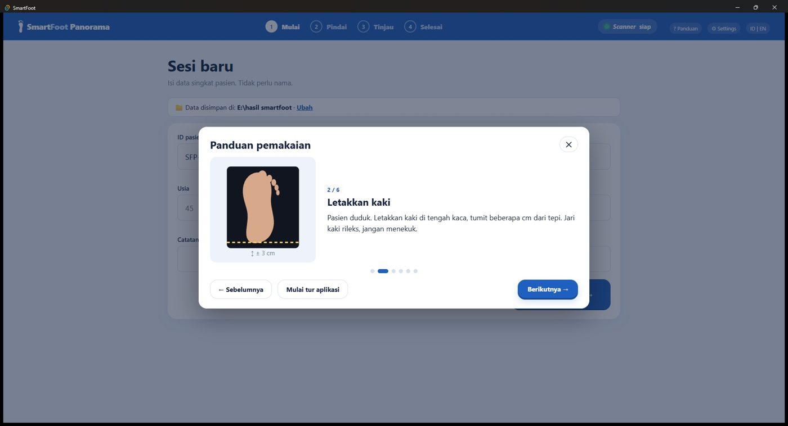
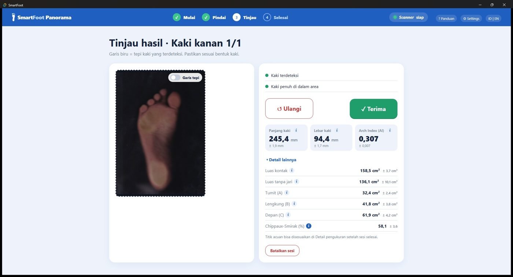
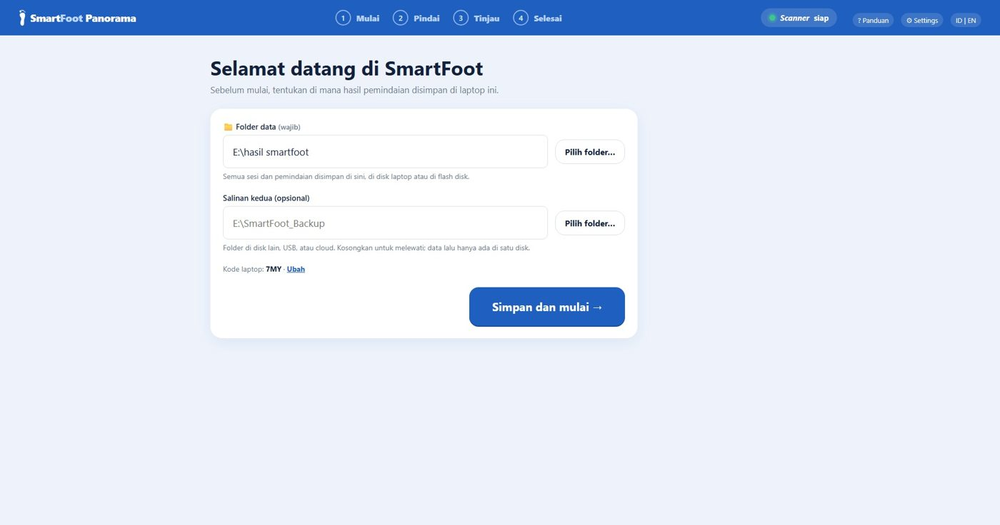

# The journey: from a plan on paper to a tested station

This is the story of how the SmartFoot Panorama app came to be what it is, written in the order things happened. Each step says what was tried, what the evidence showed and what changed because of it. The dates are from October and November 2026.

## 18–19 October: the first plan

The project started as a screening station with a lot of hardware. The first design had a weighing chair with an RS-232 indicator, a thermal camera looking at the sole, two wide-angle USB cameras for colour images, an ESP32 controlling lights and sensors inside a box, and a tablet app guiding the operator. Design options, a bill of materials and a guide for each team member were prepared so the choice could be made before anything was bought.

## 29 October: the pivot to flatbed scanners

The plan changed completely after review. The thermal camera and the weighing chair were dropped, and the station became a pair of ordinary flatbed document scanners imaging the sole of a seated person. This is not a new idea: earlier work had already modified CanoScan scanners with a thicker glass and a stronger frame to measure footprints. The engineering problems therefore moved to two places, carrying the weight of a foot on a scanner and getting a sharp image when the foot sits above the scanner's very shallow focus, and the software became its own part of the project.

The first day with the scanners was spent finding out what they actually do. Both a CanoScan LiDE 110 and a LiDE 300 could be driven from Windows without the Canon app, through Windows Image Acquisition. The scanners have a transport lock, and a locked scanner silently returns a blank image of identical rows, which later became a dedicated check in the app. Timing runs showed that the LiDE 300 needs about 12 seconds per scan, with a 9.5 second penalty when it starts cold, which is why the app now does a warm-up scan after a long idle. An ID card measured on both scanners confirmed that the nominal 300 dpi was right within about half a percent. The LiDE 300 also turned out to have two driver routes: the Canon driver clips the whites and crushes the blacks, while the Windows driverless route keeps the tonal range, so the driverless route became the default. In the middle of one test run Windows Update silently installed an empty "Null Driver" for the scanner and broke the Canon route, which is why the app looks for that driver and tells the operator what to do.

## 2 November: specification and first build

The app was specified in one long session before any code was written. It would be a Windows desktop app built with Tauri, with the image work in Rust and the interface in plain web technology, Indonesian by default because the station is meant for nurses. The nurse flow was fixed at four steps (start, scan, review, done), the patient is identified only by a generated pseudo-ID, and the measurements are saved but no flat, normal or high label is ever shown, because the published arch index cut-offs were made for standing feet. Clickable mock-ups of the screens were compared and one design was chosen. By the end of the day the app could drive the scanner, find the outline of an object on the glass, store sessions with accept and retake, measure foot length, width, contact area, the Cavanagh arch index and the Chippaux-Smirak index, and let the team correct the foot axis by dragging two points. Each laptop got its own short code inside the patient IDs so that two stations never produce the same ID.

## 3–4 November: making it robust, then trying to break it

The next day added the parts a real station needs: a scanner status chip that is checked every few seconds, a start gate that refuses to begin when the scanner is missing or locked, resuming a session that was interrupted, and a second copy of all data in another folder.

Then the app was deliberately attacked. The rule was simple: an accepted scan is never lost or corrupted, the app never writes a wrong number silently, and every failure shows a plain message saying what to do. Twenty-nine automated tests fed it empty glass, pure noise, one-pixel images, truncated files, a scanner driver that never answers, two feet at once and a ruler pretending to be a foot. Nine real bugs came out of this: tiny images crashed the outline finder, a hanging driver would have frozen the app forever, a failed save could lose an accepted scan, two objects on the glass were silently reduced to one, a ruler was measured as a foot complete with an arch index, settings files saved with a byte-order mark were rejected, and a few inputs were not validated. All were fixed the same day.

A hands-on checklist followed on the real scanner: pulling the USB cable mid-session, closing the window during a scan, ending the process in Task Manager right after pressing Accept, opening the app twice, pointing the backup at a drive that disappears (faked with `subst`) and filling the disk completely (with a 100 MB virtual disk). Six findings came out of it, from an empty glass being reported as a foot to a message that blamed the lock switch when the cable had been pulled. They were all fixed on 4 November, and the full list is in [NEGATIVE_TESTS.md](NEGATIVE_TESTS.md).

## 11 November: the case arrives, and the image goes soft

The final case put a 10 mm acrylic window between the foot and the scanner glass, and the first scans through it changed the picture. The sole now sat about 10 mm above the scanner's focus, so all skin texture was gone and the edges were blurred over several millimetres. Worse for the software, the sole now looked darker than the background, the opposite of the hand scans used so far, and the outline finder fell apart: it found a foot on empty glass, missed half a foot entirely and outlined an ID card as if it were a quarter of the image.

The outline finder was rebuilt around what still separates skin from everything else in a blurred image, its red tint. Strongly reddish pixels seed the outline, a threshold at half their strength grows it, paler skin is added only where it connects to those seeds, and the background is modelled as a smooth surface instead of a flat level. The new finder was checked against the real case scans in an automated test. The same day showed that the LiDE 300 refuses to scan with its own glass panel removed, so the app's error message now mentions that too.

## 13 November: calibration, the cover, and a sharper image

The scale was calibrated on the final case with rulers lying on the acrylic, exactly where a foot goes. The millimetre ticks are too blurred to measure one by one, but hundreds of them in a row have a very precise spacing, which a Fourier transform recovers. A steel and a plastic ruler, on both their millimetre and inch scales, all agreed on 300.7 dpi along the scan direction. Across the sensor the blur is wider, so the inch marks were used instead, giving 299.5 dpi; a first estimate of 297 dpi from one strip turned out to be noise once a second scan was compared. Laying a white cloth over the ruler made the ticks the clearest of all, so that became the calibration procedure. One more surprise came on the way: after a restart the driverless scanner route disappeared from Windows, and the Canon route that was left produced almost black scans. The app already prefers the driverless route; the lesson was to check which route is active before trusting a scan.

The next question was what should cover the foot. The expectation was a white cloth, based on the 11 November scans, but those had been taken with a block of styrofoam over the foot that nobody remembered, so they could not answer it. The measurement was repeated properly with no cover, a white cloth and a black cloth, with the room lights off and on. A black cloth gave the most contrast between sole and background and an even background without folds, and with the room lights on it kept that contrast while the uncovered foot almost disappeared into the background.

The biggest single improvement of the day was mechanical. There was still room under the scanner, and raising it closer to the acrylic, first on cardboard and then on a stiff spacer that leaves a small gap so the scanner never carries any weight, brought the sole from a blur to a picture with visible skin creases. A ruler scan after the spacer went in showed the scale unchanged.

With the hardware settled, the same right foot was placed ten times, lifted fully each time. Two placements would have been retaken in normal use, one with curled toes and one touching the edge. Over the other eight, foot length varied by ±1.9 mm around 244.8 mm, and a tape measurement of the same foot gave 245 mm. The earlier estimate of ±0.6 mm, from four scans, had been too optimistic, which is exactly why the longer run was worth doing.

## 13 November: the interface grows up

With measured numbers to stand on, the review screen started showing them. Foot length, width and arch index now appear with their precision from the repeat test. Every value has an information button that explains it in plain words, shows the measurement on the patient's own scan (the axis drawing itself, the footprint splitting into thirds, the formula appearing) and cites its source. The outline can be switched off to see the raw scan. The research screen was renamed to measurement details, and moving the reference points became an explicit mode with a reset button. A first-run setup now asks where the data should be saved, the start screen always shows that folder, and scanning is blocked when it cannot be reached, which matters when the data lives on a flash disk. A short illustrated guide, a first-run tour, a calibration animation in Settings and a new footprint logo with an opening animation finished the round.

Finally a complete session was run on the real station and recorded screen by screen, including a retake of the first right-foot scan, which the review screen caught because the toes were curled.

| Scanning | Session done |
|---|---|
|  |  |
| **Foot length, with the scale explained** | **Guide** |
|  |  |
| **More details on the review screen** | **First-run setup (rendered in the test harness)** |
|  |  |

## What is still open

The outline along the inner arch is still jagged where the lifted arch fades into the background, and curled toes can leave notches between them; both are next on the list for the outline finder. The precision figures come from one foot of one person and should be repeated on more people. The arch index cut-offs for a seated foot do not exist yet, so the app keeps showing the number without a label until there is data to support one.
